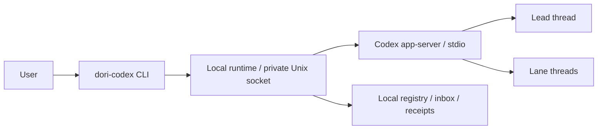

# dori-superagent-for-codex

A local multi-session harness built on **Codex app-server**. Derived from [sisyphuslabs/dori-superagent](https://github.com/sisyphuslabs/dori-superagent), preserving its brief → lane → evidence → review → merge workflow.

[한국어](README.ko.md)

One lead coordinates tasks. Each lane is a persistent Codex thread. A local duty loop batches queued messages, nudges idle work and reports missing sessions. Completion needs evidence; merging needs a CLEAR review at the exact current head/base pair plus at least one passing check.



## A calm conversation with an internal work lead

Attach an existing conversation with `up --connect ws+unix:///absolute/socket --lead THREAD --split`. The separate internal work lead receives lane chatter, finds related work, steers running tasks when the owner changes direction, and verifies completion. The conversation receives compact completion batches and important decisions. Task revisions and explicit worker acknowledgements keep stale results from completing newer requests. Pages remains the dashboard, with task results organized as 요약 / 정할 것 / 상세.

See [split-lead operations](docs/split-lead.md) and [upstream messenger support](docs/messengers.md). Optional Slack, Discord and Telegram behavior is adapted from upstream and remains disabled until explicitly configured; no messenger connection starts with Dori. `messenger start --config /absolute/FILE` explicitly runs authenticated owner inbound admission and automatic replies to each completed task's original route; `messenger stop RUNNER_ID` requests cooperative shutdown.

## Install and use

Requires Bun 1.3+, Codex CLI 0.164+ with `app-server`, Git 2.38+ and a completed `codex login`. GitHub review/merge commands also need authenticated `gh` and a configured Git author identity. macOS and Linux are supported; the local transport uses a Unix socket.

```sh
git clone https://github.com/justice-hwan/dori-superagent-for-codex.git
cd dori-superagent-for-codex
bun install --frozen-lockfile --ignore-scripts
bun link

dori-codex up --cwd /absolute/path/to/project
dori-codex doctor
dori-codex send lead --text 'Inspect this project and propose the next authorized task.'
dori-codex read lead
dori-codex status
dori-codex down
```

`up` starts one owned local app-server process and creates/resumes role threads. Without `--auto-loop`, it does not start a model turn until a message is sent. `down` interrupts owned turns and stops this runtime; stored threads can be resumed later. Existing shared Codex services and remote hosts are not stopped. This package does not register any login service or scheduled job.

### Shared local app-server and an existing lead chat

To use an already running local Codex app-server and your existing chat as lead, choose a separate state home:

```sh
export DORI_HOME=/absolute/path/to/shared-dori-state
dori-codex up --connect ws+unix:///absolute/path/to/app-server.sock --lead EXISTING_THREAD_ID
dori-codex send lead --text 'Continue the authorized work'
dori-codex down
dori-codex up  # reuses this home's saved connection.json and lead
```

Only local Unix WebSockets are accepted. The lead must already be loaded (idle or active) on that server at registration. Dori rejoins with only `threadId` and `excludeTurns`; it preserves the chat's title, instructions, tools, policy and native approval flow. Plain shared mode creates no synthetic lead or duty model thread; explicit `--split` adds only the internal work lead, and duty remains code. New Dori workers are named `🐾dori/{topic}` when the server supports `thread/name/set`.

Reports steer an active, unblocked external lead using the freshly read current turn ID. Idle leads receive a new turn. Busy workers and approval/input blocked chats keep messages queued. Both submission paths use the stable inbox batch ID. An unknown response, timeout or disconnect retains uncertainty and prevents replay; inspect native history before `reconcile`. A definitive turn precondition rejection keeps the same batch queued for a later refreshed attempt, without a fallback submission in that attempt.

The external lead cannot be archived, closed or interrupted by Dori, and its approval/input requests stay with the native app. A successful worker `turn/start` may add input to a raced native turn; Dori proves creation through that turn's first user message `clientId` before owning its interruption or requests. Missing provenance keeps cleanup unconfirmed. Shared mode never calls `thread/archive`: closing a worker retires only its local Dori registration, and finished review chats remain available in Codex. Shared `down` closes new submission admission, drains in-flight operations, confirms owned turns interrupted or already terminal, and disconnects only this client; unrelated/native turns and the shared service remain alive. Unconfirmed cleanup reports an error and retains runtime ownership for inspection. Dori never spawns, signals, restarts or shuts down a shared app-server.

Migration and rollback: stop the old Dori runtime with its original `DORI_HOME`, retain that home's state, and start shared mode in a new home. A live mode/endpoint/lead mismatch and lead replacement are refused. To roll back, stop the shared Dori runtime, restore the original home and run `up` there; a fresh home can explicitly select `up --owned`. Do not edit a live home's connection settings. These behaviors have offline fixture coverage; this change does not claim live shared-server/model validation.

`bash install.sh` links this checkout's CLI and the `dori-codex` skill. It never pulls updates or starts services. The command name is `dori-codex`, so an existing `dori` command is preserved.

## Tasks and evidence

```sh
dori-codex start fix-login --brief ./brief.md --cwd /absolute/project
dori-codex send fix-login --text 'Also verify the existing regression case.'
dori-codex report fix-login --text 'Regression reproduced; patch under test.'
dori-codex ready fix-login --text 'Patch ready for review.' --evidence https://github.com/owner/repo/pull/123
dori-codex review owner/repo#123
dori-codex merge owner/repo#123 --dry-run
dori-codex merge owner/repo#123
dori-codex done fix-login
```

READY is a claim. The lead must inspect the evidence. A completed model turn does not automatically mark a lane READY or merge its PR. Reviews run in a separate read-only Codex thread against immutable raw Git source and diff, and bind receipts to the repository, head, base and base branch name. Run commands from a clone containing both commits. The full review and metadata are saved locally. Only a successful turn with an explicit VERDICT and unchanged target identity can produce a receipt.

Shared reviews additionally retain the accepted submission's turn/client identity and first-message creation proof after the turn completes. The result comes from that exact turn's persisted final output. A start that appended review input to native work cannot produce a review receipt. Shared review chats are retained: archive has no expected-turn precondition to protect native work admitted after a final status check.

Review snapshots preserve all symlinks as inert target text with their original mode recorded in metadata, avoiding filesystem traversal through case or Unicode aliases. Reviewer threads suppress automatic project documentation and mark the snapshot untrusted, so its agent instructions and project hooks are reviewed as source.

`merge` checks CI by the captured head SHA and creates a fixed merge commit whose two parents are exactly the reviewed base and head. It records that candidate before pushing, then uses an explicit expected-value lease on the base ref. A concurrent base change rejects the push; branch-protection rejection has no fallback. Retries verify the saved candidate on the remote before attempting another push. This integrates only the reviewed objects and preserves upstream ancestry. Only merge commits are supported.

A PR head can move independently after the last query. Its newer commits cannot enter the fixed candidate. The command reports `INTEGRATED_REVIEWED_PAIR` until GitHub independently confirms the PR is merged at the reviewed head; it never closes a PR containing newer work. Git credentials use the existing authenticated `gh` helper. Missing checks, failed check commands, failures and all-skipped checks are refused.

Busy/blocked threads keep their messages on disk until they can receive a new turn. Inbox batches carry stable delivery IDs to avoid replay after a lost local response. Cursor-covered batches are discarded after a crash; `send` reports delivery of its own message, even when an older batch is being reconciled. A timeout or disconnection without a confirmed start is held as an uncertain delivery across restarts: inspect Codex history, then use `reconcile TARGET --delivered true|false` explicitly. `read TARGET` shows locally received assistant output; it is not a full transcript export. Full thread history stays in Codex's own local storage.

A confirmed failed turn can receive recovery instructions without restarting other lanes. New instructions invalidate a lane's earlier READY evidence once per inbox batch; acknowledgement-only retries preserve evidence produced by that batch. Closing requires READY, an empty inbox and a finished turn, and excludes concurrent instruction admission or evidence changes. A refused concurrent command can be retried after closure finishes.

Failed-turn state survives runtime restarts until a recovery turn starts. Reconciliation resumes a saved thread before checking its current idle state, and refuses concurrent delivery or closure. Backlog admission rechecks each task under the same lease used by drop/decision commands; a task cancelled while another start waits cannot launch from an older candidate list.

An idle resume is checked against the latest persisted turn summary. A missed failure remains failed; missing, unrelated or unfinished outcomes become `recovery` and cannot authorize closure. New recovery instructions can start a fresh turn. Uncertain delivery still requires explicit reconciliation. `read` shows output received by this local runtime; the complete history remains in Codex.

Lane and backlog names cannot be `lead`, `duty` or an existing thread ID. Kickoff addresses the newly allocated thread directly.

## Approval and interruption

New threads use `on-request` approval and a `workspace-write` sandbox. Reviewer threads use `read-only`. No approval is granted automatically.

```sh
dori-codex requests
# Inspect the request, then write its exact response object to a file.
# Command/file approval example: {"decision":"decline"}
dori-codex requests answer REQUEST_ID --json /path/to/response.json
dori-codex interrupt fix-login
# If a send was marked uncertain: inspect Codex history, then state whether it arrived.
dori-codex reconcile fix-login --delivered true
```

Only registered threads can receive messages. Interruption requires a proven Dori-owned worker turn; the external lead is protected. Owned stdio mode archives its worker chats on close. Shared mode closes only local registration and never archives Codex chats. Pending owned-worker questions and approvals are shown by `requests`; answering requires an explicit response file. External/unrelated requests stay with the native app. Credentials remain with Codex's login flow.

Interruption waits for an in-flight submission and confirms the turn's completion event. An unresolved turn or missing confirmation is reported as unconfirmed. Reviews allow 20 minutes of model work, with additional time for setup and cleanup; transport idle limits do not end a running review early.

A pending review question or approval remains available through `requests` while the same review keeps waiting for its result. Answer explicitly in a separate terminal; the review deadline continues to apply and interrupts timed-out work.

## Backlog and duty

The runtime runs duty every 60 seconds. Pause future passes with `duty stop --text maintenance`, inspect with `duty status`, and resume with `duty resume`. This does not interrupt a turn already running; use `interrupt` for that. It nudges idle working lanes at 10 and 20 minutes and escalates at 40; WAITING/blocked work is left alone. A failure in one lane does not stop the others.

Role lookup, creation and registration share a per-home startup lease. Concurrent `up` calls reuse the registered roles or report busy instead of replacing them.

```sh
dori-codex backlog add task-one --brief ./brief.md --priority 2
dori-codex loop --once
dori-codex loop stop --text 'maintenance'
dori-codex loop resume
```

The hourly backlog loop is opt-in (`up --auto-loop`, or run `loop` separately). Its default budget is 3 open lanes and 2 starts per run, subject to host load. Add only authorized tasks. `up --auto-loop` takes effect when starting a stopped runtime.

The loop rechecks current open lanes, host load and its stop switch before each start. Explicit `start` commands allocate outside this loop budget. An item's admission and drop/decision updates share a lease; commands report busy while its start is in progress and can be retried afterward.

## Local state and communication

State defaults to `~/.dori-codex`, separate from older installations. `DORI_HOME` changes it and is resolved to an absolute directory before storage, socket identity, daemon startup and generated commands. Session records, inboxes, requests and logs are private local files. The runtime listens on a mode-0600 Unix socket. A dead runtime/inbox lease is reclaimed under a serialized claim gate. A crash during the short claim section leaves a `.claim` file for explicit owner inspection; it is not automatically removed. Shutdown verifies exit of its own child, using bounded TERM/KILL escalation if needed. `DORI_CODEX_BIN` selects the Codex executable, not a shell command.

There is **no usage collector, install registration, analytics key or telemetry sender in this fork**. Dori's own communication is the local runtime Unix socket and owned app-server stdio or an explicitly selected local Unix WebSocket. Codex model requests and user-configured Codex tools/providers still use their normal connections. GitHub operations use `gh`. Optional Slack, Discord and Telegram primitives are adapted from upstream; none starts or reads credentials with Dori. Explicitly configured sends use the original task origin. Notion and Kakao integrations are not bundled.

By default this runtime starts its own app-server with the user's existing Codex configuration. Shared mode explicitly attaches to an existing local server. Automatic visibility or immediate refresh in the Codex desktop sidebar is not guaranteed; persisted thread IDs can be opened/resumed with compatible Codex clients.

Normal threads use a per-thread workspace permission profile adding the private state directory and exact local Unix socket. A managed proxy uses an empty domain allowlist; this does not grant arbitrary command networking or change global configuration. Review threads retain their separate read-only policy. A stopping runtime is never reported ready; active-work permission failures retain ownership for inspection.

## Verify

```sh
bun run typecheck
bun run check:boundaries
bun test ./test/
# Explicit opt-in: uses the signed-in Codex model for one marker response.
bun run smoke:live
# Explicit opt-in: the model writes only a fixture project and executes report/ready.
bun run smoke:lane
```

Offline tests use an in-memory harness, a fake stdio app-server process and a fake Unix-WebSocket app-server, including JSON-RPC and CLI integration. They do not invoke a model, send external messages or control production processes. The live smoke uses an isolated owned Dori home, archives its test thread and stops its runtime; it does not validate shared mode.

## Keep upstream

```sh
dori-codex upstream check
# In a clean local checkout, create a dedicated integration branch:
git switch -c integrate-upstream
git merge --no-commit upstream/main
# Resolve conflicts while preserving Codex runtime and communication boundaries.
# Run typecheck, boundary checks, offline tests and live smoke; commit, push and review the PR.
```

`upstream check` uses `.upstream.json`, verifies the remote identity, fetches the declared branch and lists commits since the integrated SHA. On a fresh clone it registers the declared upstream remote. It never pulls, merges, commits, pushes or schedules an update. A rewritten upstream history requires manual inspection. Advance `integratedCommit` only in the reviewed integration branch after resolving every incoming change. Use merge commits for both upstream integration and the resulting fork PR to preserve ancestry.

Original baseline: upstream `248c291319a1e45db061f1b3eae1cce9640084f7`; the integrated upstream SHA is tracked in `.upstream.json`. Keep the original MIT license and attribution. Upstream integrations must pass `check:boundaries` before adoption. See [migration notes](docs/migration.md).
